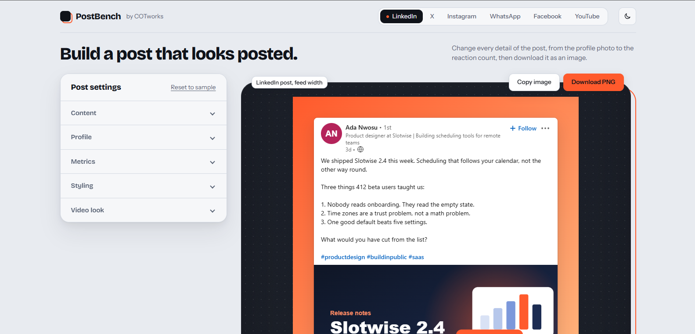

# PostBench

PostBench is a social post simulator. Pick a platform, change every detail of the post, and download it as an image. It covers LinkedIn, X, Instagram, WhatsApp, Facebook, and YouTube. Everything runs in your browser, so there is no account to create and no server behind it.

**[Live Demo](https://crypticot.github.io/postbench/)**



---

## Why this exists

Designers, founders, and marketers regularly need a post that looks real without publishing anything: a mockup for a client deck, a screenshot for a case study, a sample for a tutorial. Most tools that do this ask for a sign-up, put a watermark on the result, or cover only one platform.

PostBench is one file that does the whole job. You edit the post on the left, see it on a bench on the right, and download a PNG. Nothing you type or upload leaves the browser.

---

## What it does

- **Six platforms**: LinkedIn, X, Instagram, WhatsApp, Facebook, and YouTube, each drawn with that platform's own layout, icons, colors, and system font
- **Edit every detail**: names, profile photos, post text, photos, reaction counts, comment counts, timestamps, badges, and the small labels in between. Hashtags, mentions, and links are colored the way each platform colors them
- **LinkedIn**: post as a person or a company page, connection degree, audience icon, Follow button, up to three reaction icons, and an optional "...more" cut-off
- **X**: feed view and post page view, Light, Dim, and Lights out themes, blue, gold, and gray badges, and threads of up to 10 posts. Every post in a thread has its own text, up to 4 photos, and its own reply, repost, like, and view counts. Counts print the way X prints them, such as 3.8K and 182K
- **Instagram**: carousels of up to 20 photos with the slide counter and dots, a "Slide to show" control for choosing which slide you export, square, portrait, and landscape shapes, a story ring, a Liked by line, and visible comments
- **WhatsApp**: a full chat screen with sent and received messages, delivery ticks, reply quotes, reactions, photos, date labels, group sender names, and `*bold*`, `_italic_`, and `~strike~` formatting. You can reorder messages, and light and dark themes are included
- **Facebook**: photo grids that follow Facebook's layouts, including the "+N" tile on the last photo, up to three of the seven reactions, coloured text backgrounds, visible comments, and a "Write a comment" row
- **YouTube**: a feed card and a watch page, with a thumbnail, length chip, watched-so-far bar, Subscribe or Subscribed button, description box, and a top comment
- **Video look**: switch any photo on any platform to look like a video, with a play button, a length, and the controls that platform shows. You can also upload a real video file, and PostBench grabs a frame from the middle and reads the length for you
- **Export**: Download PNG at 2x size, or Copy image straight to the clipboard
- **Backdrop**: a transparent background for placing the post on your own design, white, ink, four gradients, or any custom color, with adjustable padding
- **Layout controls**: three width presets per platform, three corner styles, and a light or dark theme for the post
- **Reset**: Reset to sample returns the current platform to its starting post
- **Theme**: the tool itself has light and dark themes and follows your system on the first visit
- **Works on phones**: the controls stack under the preview, and a wide post scales down to fit the screen while the export stays full size

---

## Tech stack

Built in vanilla HTML, CSS, and JavaScript, in one file. Just open `index.html`.

- No framework and no build step
- [html2canvas](https://html2canvas.hertzen.com/) 1.4.1 from cdnjs turns the preview into a PNG. It is the only script the page loads
- Browser storage (`localStorage`) remembers your edits between visits
- Google Fonts: Bricolage Grotesque (headings) and Instrument Sans (body) for the tool itself, with system fonts as the fallback. The posts use each platform's own system font stack

---

## Running it locally

```bash
git clone https://github.com/crypticot/postbench.git
cd postbench
```

Open `index.html` in any modern browser. There is nothing to install and no server to run. The PNG export needs an internet connection the first time, so the page can load html2canvas.

---

## Adding a platform

Every platform is one entry in a registry. The controls, the preview, the tab, and the export all pick it up from there.

```js
PLATFORMS.mynet = {
  id: 'mynet',
  label: 'MyNet',
  postName: 'MyNet post',
  widths: { mobile: 360, feed: 420, wide: 560 },
  defaults: { text: 'Hello', theme: 'light', width: 'feed', radius: 'standard',
              backdrop: 'none', padding: 48 },
  sections: [
    { title: 'Content', open: true, fields: [
      { key: 'text', type: 'textarea', label: 'Post text', rows: 5 }
    ] }
  ],
  render: function (s) {
    return '<article class="mynet">' + /* HTML for the post */ '</article>';
  }
};
```

Field types include `text`, `textarea`, `number`, `toggle`, `seg`, `range`, `swatches`, `image`, `images`, `posts`, `messages`, and `multi`. Style the post with its own scoped class so it never touches the tool's interface.

---

## A few design decisions worth knowing

**Why every platform is a registry entry.** The tool does not know what a LinkedIn post or a WhatsApp chat is. It knows how to build controls from a list of fields and how to show whatever HTML a platform returns. That is why six very different layouts share one preview, one export, and one reset.

**Why the posts use system fonts.** The real apps draw their text with the font of the device, so the mockups do the same. It also means there is no web font to wait for before a PNG is taken.

**Why the export works on a full-size copy.** On a small screen the preview is scaled down to fit. Before the PNG is taken, the page clones the post at its true size with the scaling removed, so the file is always full resolution however small your screen is.

**Why a video is marked inside the photo itself.** A photo becomes a video when its data ends in `#v`. Because the mark travels with the photo, reordering, removing, duplicating, and saving photos all keep the video look with no extra bookkeeping. Profile photos and YouTube thumbnails are left out on purpose.

**Why thread stats are typed in, not worked out.** Real threads have different counts on every post, and any formula would look invented. Each post in an X thread has its own numbers.

**Why your edits are kept in the browser.** That is what keeps the tool private and account-free. The tradeoff is that browsers limit how much a page can store, so a post with many large photos may not be saved between visits. Download the PNG before you close the tab.

---

## Good to know

- The sample names, text, and numbers are placeholders. Replace them with your own
- Text cut-off points, such as where "See more" appears, are close approximations. The real apps change them by device
- The WhatsApp screen follows the Android layout
- Real video files work best as MP4 (H.264). Others may not decode in the browser

---

## Use it responsibly

PostBench is for mockups, demos, tutorials, and presentations. Do not use it to impersonate a real person or to pass a fabricated post off as real. LinkedIn, X, Instagram, WhatsApp, Facebook, and YouTube are trademarks of their owners. This project is not affiliated with or endorsed by any of them.

---

## Built by

**Chidubem Ojukwu** · [Portfolio](https://crypticot.github.io/cotworks-portfolio/) · [LinkedIn](https://linkedin.com/in/ojukwuii)

Created by COTworks. A single-file tool for anyone who needs a believable post without publishing one.
